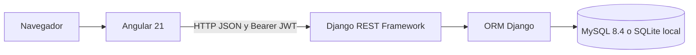

# Arquitectura

## Componentes

| Ruta | Responsabilidad |
| --- | --- |
| `BookTrack/src/app/features/` | Autenticación, catálogo, gestión, perfiles, reservas y préstamos |
| `BookTrack/src/app/core/services/` | Clientes HTTP de la API |
| `BookTrack/src/app/core/guards/` | Acceso a pantallas según sesión y rol |
| `BookTrack/src/app/core/interceptors/` | Agrega `Authorization: Bearer <token>` |
| `BookTrack/src/app/models/` | Tipos TypeScript canónicos |
| `BookTrack/src/app/shared/` | Encabezado y componentes comunes |
| `backend-booktrack/booktrack/` | Configuración Django y distribución de URLs |
| `backend-booktrack/users/` | Usuario personalizado, registro, sesión y perfiles |
| `backend-booktrack/books/` | Catálogo, stock agregado y portadas |
| `backend-booktrack/loans/` | Reservas, préstamos, transiciones y exportaciones |
| `backend-booktrack/categories/` | Catálogo de categorías |
| `backend-booktrack/comments/` | Recepción de comentarios de usuarios |

## Comunicación

Django expone `/api/users/`, `/api/books/`, `/api/reservations/`, `/api/loans/`, `/api/categories/`, `/api/comments/` y `/api/token/refresh/`. La API entrega listas planas, sin paginación global, porque así las consumen los servicios existentes.

En desarrollo Angular corre en 4200 y llama directamente a Django en 8000. CORS admite los orígenes locales 4200 y 4202. En Compose Angular se compila como archivos estáticos, Nginx escucha en 80 dentro del contenedor y publica 4202. `/api/` se reenvía a `backend:8000`; la configuración de producción usa una URL relativa.

`python-decouple` lee variables de entorno y el `.env` del backend. Compose recibe sus variables del `.env` de la raíz e inyecta los valores al contenedor. Son configuraciones independientes.

## Seguridad y consistencia

- JWT SimpleJWT: access de ocho horas y refresh de siete días. El login actual entrega solo el access; el endpoint de refresh existe pero la interfaz no implementa una renovación automática con refresh.
- El backend verifica rol y propiedad de cada reserva/préstamo; el guard del navegador es una ayuda de navegación.
- El registro público crea usuarios comunes. Las operaciones de retiro, devolución y resolución de renovaciones requieren bibliotecario.
- Las modificaciones del catálogo requieren bibliotecario. Un usuario común accede a su propio perfil.
- Las transiciones viven en `loans/services.py`. Las operaciones de stock bloquean primero el libro y luego la reserva o el préstamo dentro de una transacción.
- Reservas y préstamos no admiten PATCH/DELETE genéricos. Django Admin los muestra en modo de consulta para no saltarse las transiciones.
- Las relaciones con usuarios y libros protegen el historial frente al borrado.

SQLite permite desarrollar y probar los contratos, pero no ofrece la misma semántica de bloqueo de filas que MySQL. La prueba simultánea de retiros se ejecuta únicamente en MySQL.

## Alcance del despliegue

El Dockerfile del backend usa Python 3.12. El frontend se compila con Node.js 24. MySQL persiste en `mysql_data`; los archivos de `media` usan un bind mount. Las portadas nuevas y fotos de perfil se guardan como data URI en la base; parte del catálogo utiliza assets incluidos en Angular.

Los vencimientos se actualizan al consultar la API y con `python manage.py actualizar_estados`. No existe un proceso programado incorporado. Un despliegue que necesite actualizar estados aun sin tráfico puede ejecutar ese comando diariamente con su planificador.
