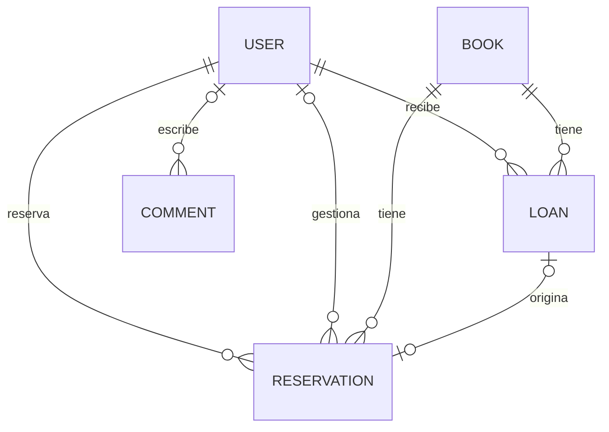
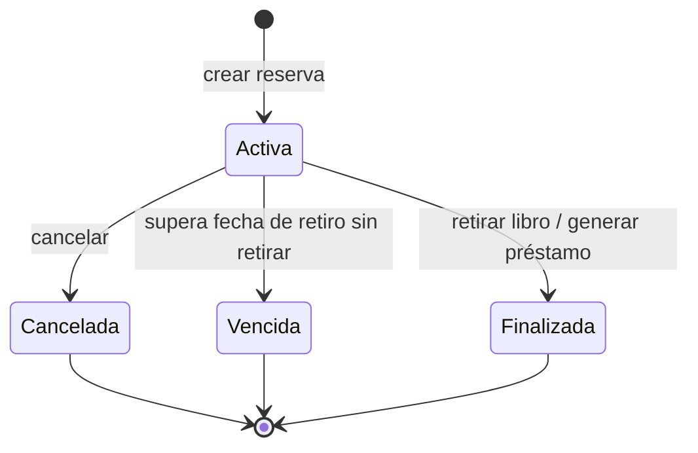
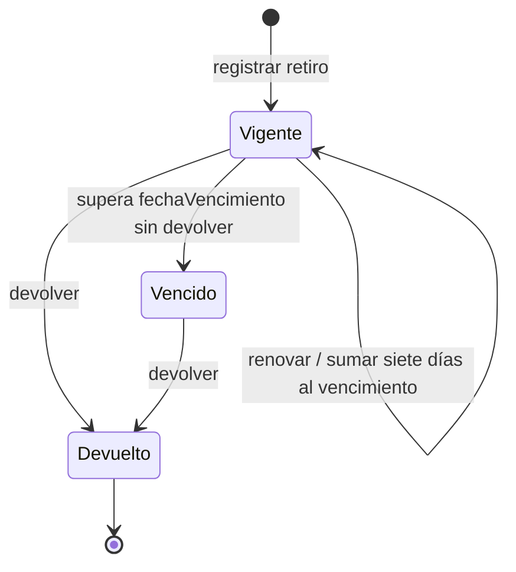

# Modelo de datos y reglas

## Entidades implementadas

| Modelo / tabla | Datos principales |
| --- | --- |
| `User` / `users` | Usuario Django personalizado, nombre, email, legajo, código, categoría `usuario` o `bibliotecario`, imagen |
| `Book` / `books` | PK numérica, título, autor, editorial, fecha de publicación, descripción, portada, códigos, categoría, año de cursada, disponibles, tipo, estado |
| `Reservation` / `reservations` | Código único, usuario, libro, bibliotecario opcional, fechas de reserva/retiro/devolución prevista, prioridad, estado, préstamo generado opcional, copia histórica de solicitudes migradas |
| `Loan` / `loans` | Usuario, libro, tipo, fecha de inicio, vencimiento, devolución efectiva, estado, período original, solicitud y resultado de renovación |
| `Category` / `categories` | Categorías ofrecidas por la aplicación |
| `Comment` / `comments` | Usuario opcional, sección, comentario y fecha |

`Book.estado` es `activo` o `inactivo`. Inactivar bloquea nuevas reservas y entregas; mantiene el historial y permite devolver préstamos abiertos. `disponibles` sigue siendo un contador agregado de copias, no una tabla de ejemplares individuales.

## Reserva

- `fecha_reserva`: fecha local de creación.
- `fecha_vencimiento`: último día permitido para retirar, inclusive.
- `fecha_devolucion_prevista`: vencimiento que tendrá el préstamo generado.
- Las nuevas reservas requieren retiro desde hoy en adelante y devolución prevista igual o posterior al último día de retiro.
- Se permiten reservas sin stock para mantener una cola. Una persona no puede tener dos reservas activas del mismo libro.
- Mayor `prioridad` se atiende primero; en empate, menor fecha de reserva y luego menor ID. El rango es 0 a 32767 y solo bibliotecario lo cambia.
- Con N copias disponibles pueden retirar las primeras N reservas activas de la cola. Las vencidas y canceladas no bloquean la atención.
- Crear, cancelar o vencer una reserva no cambia el stock. Solo el retiro lo reduce.
- Una reserva finalizada referencia exactamente un préstamo. Reintentar el retiro devuelve el mismo resultado, sin duplicar préstamo ni descontar otra copia.

## Préstamo

- `fecha_inicio`: fecha efectiva de retiro; la API la llama `fechaInicio`.
- `fecha_vencimiento`: devolución prevista; la API la llama `fechaVencimiento`.
- `fecha_devolucion`: devolución efectiva, nula hasta registrar la entrega; la API la llama `fechaDevolucion`.
- La fecha límite es inclusiva según `America/Argentina/Buenos_Aires`; pasa a vencido cuando el límite es menor que la fecha local actual.
- Solo un préstamo vigente admite solicitar una renovación. Bibliotecario resuelve esa solicitud; aprobar suma siete días al vencimiento, sin cambiar inicio, stock ni estado.
- Devolver un préstamo vigente o vencido registra la fecha efectiva y repone una copia una sola vez.
- `extension_pendiente` y `extension_estado` describen la gestión de una renovación. No son estados del préstamo.
- Un aviso visual de "vence pronto" tampoco representa un estado `PorVencer`.

## Correspondencia con el diseño conceptual

El PDF es un modelo de análisis. La implementación conserva los nombres y claves que ya usa este repositorio:

| Concepto del PDF | Implementación |
| --- | --- |
| Usuario / Bibliotecario separados | Un modelo `User` con `categoria` |
| Libro identificado por ISBN | `Book.id` numérico y códigos de catálogo/inventario |
| Reserva | `Reservation`, con estados y campos corregidos |
| Préstamo | `Loan`, relacionado con el libro y no con un ejemplar individual |
| Ejemplar | Stock agregado `Book.disponibles`; no hay tabla ni CRUD de ejemplares |
| Notificación | Avisos calculados por el encabezado Angular; no hay tabla ni entrega por email |
| AcciónAdministrativa | No existe una tabla específica de auditoría de negocio |
| Favorito | No hay una tabla ni funcionalidad implementada |

No se agregó una estructura de ejemplares, favoritos o auditoría completa a partir de notas ilegibles. Estas diferencias quedan explícitas para que el PDF no se confunda con una descripción exacta del esquema físico.

## Migración de datos existentes

`books.0009` agrega el estado activo a libros existentes. `loans.0006` renombra `fecha_fin` a `fecha_vencimiento`, agrega devolución efectiva y separa solicitudes de préstamos reales:

| Estado anterior | Resultado |
| --- | --- |
| `pendiente` | Reserva activa si su inicio aún no pasó; vencida en caso contrario |
| `denegado` | Reserva cancelada |
| `aprobado` | Préstamo vigente o vencido según su fecha límite |
| `devuelto` | Conserva el préstamo devuelto |

Las solicitudes convertidas guardan todos sus campos originales y el ID anterior en `Reservation.datos_legacy`, con código `LEGACY-<id>`. Se conservan los IDs de los préstamos reales y sus fechas. La migración no recalcula ni modifica stock. Una fecha histórica desconocida permanece nula: no se inventan fechas de devolución ni plazos.

La fecha de inicio de una solicitud antigua se usa como límite de retiro porque el esquema anterior no guardaba una fecha de reserva independiente. Si una reserva histórica activa carece de devolución prevista, no se puede retirar: se cancela y se registra una nueva con fechas completas.

La separación no admite rollback automático; el intento falla antes de revertir el esquema. Para volver a la versión anterior hace falta restaurar un respaldo consistente junto con el código anterior. Ver [OPERACION](OPERACION.md).
