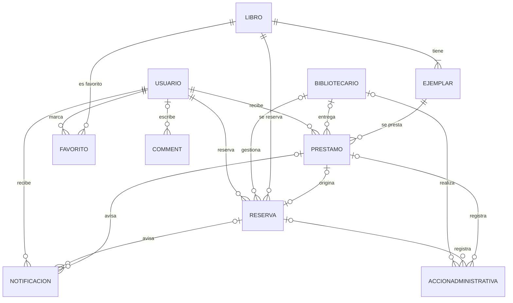
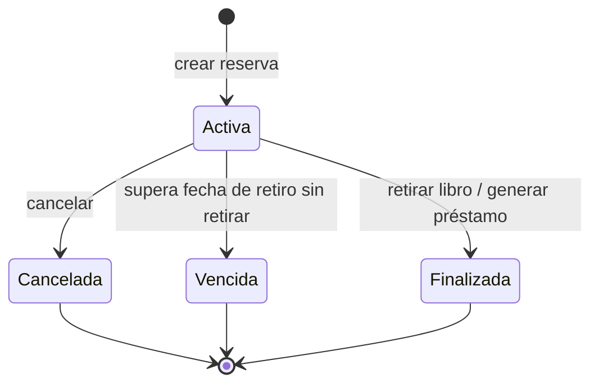
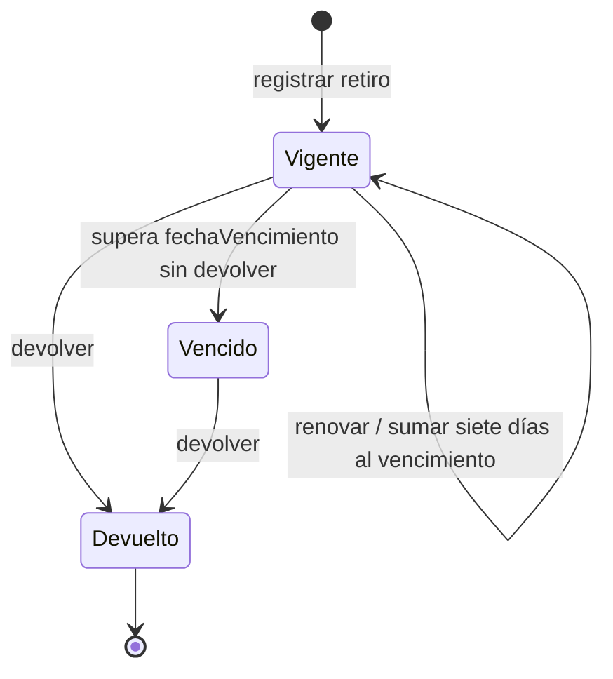

# Modelo de datos y reglas

El esquema sigue el diagrama de clases del proyecto: tablas `Usuario`, `Bibliotecario`, `Libro`, `Ejemplar`, `Reserva`, `Prestamo`, `Favorito`, `Notificacion` y `AccionAdministrativa`, con los nombres de columna del diagrama (`idUsuario`, `fechaReserva`, `ISBN`…).

## Entidades implementadas

| Tabla (modelo) | Columnas principales |
| --- | --- |
| `Usuario` (`users.Usuario`) | `idUsuario` PK (**el legajo**), `nombre`, `apellido`, `email`, `emailAlternativo`, `telefono`, `tipoUsuario` (`alumno` o `docente`); además `password`, `last_login`, `is_active`, `imagen` y `codigo` (código de invitación) |
| `Bibliotecario` (`users.Bibliotecario`) | `idBibliotecario` PK (**el legajo**), `nombre`, `apellido`, `email`; además `password`, `last_login`, `is_active` e `imagen` |
| `Libro` (`books.Libro`) | `ISBN` PK, `titulo`, `autor`, `categoria`, `anioPublicacion`, `resumen`, `palabrasClave`, `estado`; además `imagen` (portada) y `anioCursada` (año de cursada, 0 = general, 99 = electivas) |
| `Ejemplar` (`books.Ejemplar`) | `idEjemplar` PK, `codigo` único, `estado` (`disponible`, `prestado`, `baja`), `ubicacion`, `observaciones`, `fechaAlta`, `ISBN` FK |
| `Reserva` (`loans.Reserva`) | `idReserva` PK, `codigoReserva` único, `prioridad`, `fechaReserva`, `fechaVencimiento`, `estado`, `idUsuario`, `ISBN`, `idBibliotecario` (opcional); además `fechaDevolucionPrevista` e `idPrestamo` (el préstamo que generó) |
| `Prestamo` (`loans.Prestamo`) | `idPrestamo` PK, `fechaPrestamo`, `fechaVencimiento`, `fechaDevolucion`, `estado`, `idUsuario`, `idEjemplar`, `idBibliotecario` (opcional); además `extensionPendiente` y `extensionEstado` (renovaciones) |
| `Favorito` (`books.Favorito`) | PK compuesta (`idUsuario`, `ISBN`) |
| `Notificacion` (`loans.Notificacion`) | `idNotificacion` PK, `fecha`, `tipo`, `mensaje`, `idUsuario`, `idReserva` y `idPrestamo` (opcionales) |
| `AccionAdministrativa` (`loans.AccionAdministrativa`) | `idAccion` PK, `fecha`, `tipoAccion`, `descripcion`, `idBibliotecario`, `idReserva`, `idPrestamo`, `ISBN`, `idEjemplar` (opcionales) |
| `categories`, `comments` | Categorías ofrecidas por la aplicación y comentarios (con `idUsuario` opcional); fuera del diagrama |

Las columnas "además" no están en el diagrama; la aplicación las necesita (portada, año de cursada, renovaciones, fecha de devolución pedida al reservar).

No hay tabla de cuentas: `Usuario` y `Bibliotecario` son las tablas de login. La clave primaria de cada una es el legajo, con el que se inicia sesión (también se acepta el email). El legajo es único entre las dos tablas: el registro y la migración lo verifican. El rol es la tabla a la que pertenece la persona, viaja en el token (`categoria`) y decide qué vistas se muestran: el usuario ve las de usuario y el bibliotecario las de bibliotecario. La API identifica a las personas por su legajo (`id`, `legajo`, `estudianteId`, `bibliotecarioId`).

`Libro.estado` es `activo` o `inactivo`. Inactivar bloquea nuevas reservas y entregas; mantiene el historial y permite devolver préstamos abiertos. El stock (`disponibles` en la API) es la cantidad de ejemplares en estado `disponible`. Bajar el stock desde la edición del libro pasa los ejemplares sobrantes a `baja`: no se borran ni se tocan los prestados.

Las acciones del bibliotecario (retiro, devolución, cancelación, priorización, renovación aprobada o denegada) dejan una `AccionAdministrativa`. Las novedades del usuario (reserva creada, cancelada o vencida, retiro, vencimiento próximo, vencido, devolución, renovación) dejan una `Notificacion`; el encabezado las lee de `GET /api/notifications/`.

## Reserva

- `fecha_reserva`: fecha local de creación.
- `fecha_vencimiento`: último día permitido para retirar, inclusive.
- `fecha_devolucion_prevista`: vencimiento que tendrá el préstamo generado.
- Las nuevas reservas requieren retiro desde hoy en adelante y devolución prevista igual o posterior al último día de retiro.
- Se permiten reservas sin stock para mantener una cola. Una persona no puede tener dos reservas activas del mismo libro.
- Mayor `prioridad` se atiende primero; en empate, menor fecha de reserva y luego menor ID. El rango es 0 a 32767 y solo bibliotecario lo cambia.
- Con N copias disponibles pueden retirar las primeras N reservas activas de la cola. Las vencidas y canceladas no bloquean la atención.
- Crear, cancelar o vencer una reserva no cambia el stock. Solo el retiro lo reduce.
- Una reserva finalizada referencia exactamente un préstamo. Reintentar el retiro devuelve el mismo resultado, sin duplicar préstamo ni descontar otra copia.

## Préstamo

- `fecha_inicio`: fecha efectiva de retiro; la API la llama `fechaInicio`.
- `fecha_vencimiento`: devolución prevista; la API la llama `fechaVencimiento`.
- `fecha_devolucion`: devolución efectiva, nula hasta registrar la entrega; la API la llama `fechaDevolucion`.
- La fecha límite es inclusiva según `America/Argentina/Buenos_Aires`; pasa a vencido cuando el límite es menor que la fecha local actual.
- Solo un préstamo vigente admite solicitar una renovación. Bibliotecario resuelve esa solicitud; aprobar suma siete días al vencimiento, sin cambiar inicio, stock ni estado.
- Devolver un préstamo vigente o vencido registra la fecha efectiva y repone una copia una sola vez.
- `extension_pendiente` y `extension_estado` describen la gestión de una renovación. No son estados del préstamo.
- Un aviso visual de "vence pronto" tampoco representa un estado `PorVencer`.

## Migración de datos existentes

Las migraciones `users.0003`, `books.0010`, `loans.0007`, `loans.0008` y `books.0011` pasan los datos del esquema anterior (`books`, `loans`, `reservations`) al del diagrama, conservando los IDs de préstamos y reservas:

| Antes | Después |
| --- | --- |
| Cuenta con `categoria='bibliotecario'` | Fila en `Bibliotecario`; el resto va a `Usuario`. `nombre_apellido` se divide en `nombre` y `apellido` (primera palabra / resto). La contraseña (hash), imagen y código pasan a la persona |
| Tabla `users` | Se elimina (`users.0005`). La clave primaria de `Usuario` y `Bibliotecario` pasa de un número a el legajo (si la cuenta no tenía legajo, su nombre de usuario) y todas las referencias se actualizan |
| Libro con `nro_codigo` `ISBN-…` | Ese código sin el prefijo pasa a ser el `ISBN` |
| Libro sin código | `ISBN` provisorio `SIN-ISBN-<id de 6 dígitos>`; editalo cuando tengas el real |
| `disponibles` N y M préstamos abiertos | N ejemplares `disponible` y M `prestado`. El `nro_inventario` queda como código del primer ejemplar; los demás son `<código>-02`, `-03`… |
| `tipo` y `editorial` del libro | Se conservan en `palabrasClave`; `descripcion` pasa a `resumen` y `anio` a `anioCursada` |
| Préstamo de un libro | Apunta a un ejemplar del libro: los abiertos a uno `prestado`, los devueltos a cualquiera. Un libro con historial y sin ejemplares recibe uno en `baja` |
| Cuenta de bibliotecario que había pedido un libro | Deja de figurar como `Usuario`: sus préstamos, reservas y avisos como usuario se eliminan (los ejemplares prestados vuelven a disponibles). Un bibliotecario no puede ser usuario |

El admin de Django se quitó (su bitácora apuntaba a `users`); los comentarios de un bibliotecario pierden autor. `tipo_prestamo`, `plazo_de_solicitud` y `datos_legacy` no tienen columna en el esquema nuevo y se descartan. El stock no cambia. Una fecha histórica desconocida sigue nula.

La separación no admite rollback automático; el intento falla antes de revertir el esquema. Para volver a la versión anterior hace falta restaurar un respaldo consistente junto con el código anterior. Ver [OPERACION](OPERACION.md).
