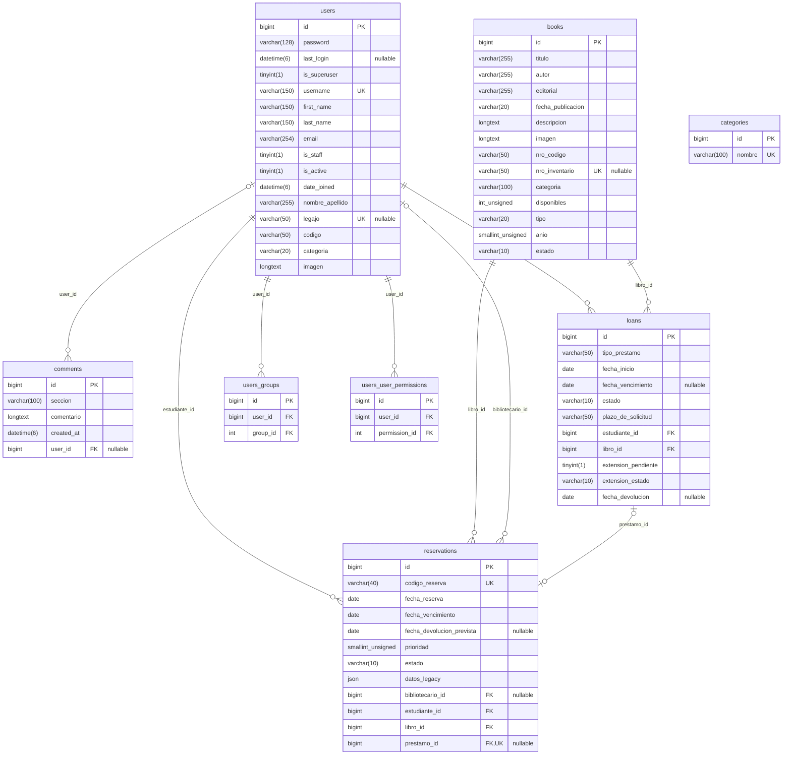

# RESUMEN_PROYECTO — BookTrack (preparación de defensa)

> Generado leyendo el repositorio y consultando **en solo lectura** la base MySQL que está corriendo en Docker (`workspacebooktrack-db-1`, MySQL 8.4.11).
> Fecha de relevamiento: 2026-11-09. No se modificó ningún archivo del proyecto (este archivo es el único agregado).
> Convención: **NO CONFIRMADO** = no pude comprobarlo en el código/BD; al lado digo dónde busqué.
> Las contraseñas de las cuentas demo **no figuran acá** a propósito: están en tu `.env` local (`ADMIN_PASSWORD`, `STUDENT_PASSWORD`).

---

## 1. Visión general

### Qué hace
BookTrack es una aplicación web de biblioteca: catálogo de libros por categoría/año de cursada, **reservas** (con cola por prioridad), **préstamos** que nacen cuando el bibliotecario registra el retiro, **renovaciones** (+7 días con aprobación) y **devoluciones**. Hay dos roles: `usuario` (alumno) y `bibliotecario` (administra libros, usuarios, reservas/préstamos, reportes y exportaciones PDF/Excel). Fuente: `README.md`, `docs/FUNCIONALIDADES.md` y el código.

### Stack
| Capa | Tecnología (versión) | Dónde se confirma |
| --- | --- | --- |
| Frontend | Angular `^21.2` (componentes standalone, rutas con guard e interceptor), TypeScript `~5.9.2`, RxJS `~7.8`, zone.js `^0.16`, SCSS | `BookTrack/package.json` |
| Tests frontend | Vitest `^4.0.8` + jsdom (vía `ng test`) | `package.json` |
| Backend | Python 3.12 (imagen Docker), Django `>=5.2,<7` (las migraciones recientes dicen "Generated by Django 6.1.2"), Django REST Framework `>=3.15,<4`, SimpleJWT `>=5.3,<6`, django-cors-headers, python-decouple, openpyxl (Excel), fpdf2 (PDF), cryptography (copias cifradas) | `backend-booktrack/requirements*.txt`, `Dockerfile` |
| Base de datos | **MySQL 8.4** (Compose; confirmado `SELECT VERSION()` = 8.4.11), driver `mysqlclient`. Alternativa SQLite solo para desarrollo/tests | `compose.yml`, `settings.py:62-76` |
| Servidor web | Nginx 1.27 sirve el build de Angular y hace proxy de `/api/` y `/media/` al backend | `BookTrack/Dockerfile`, `nginx.conf` |
| Contenedores/CI | Docker Compose; GitHub Actions (tests backend con MySQL, tests+build frontend, build/push de imágenes a GHCR) | `compose.yml`, `.github/workflows/ci-cd.yml` |
| Auth | JWT (access 8 h, refresh 7 d). El rol viaja dentro del token (`categoria`) | `settings.py:107-111`, `users/serializers.py:57-59` |

Versiones locales de tu PC (no son las del proyecto): Python 3.13.14, Node v22.23.1. El README pide Python 3.12 y Node 24 para correr **sin Docker**; con Docker no importa. Si corrés sin Docker: **NO CONFIRMADO** que funcione con Node 22 / Python 3.13 (no lo probé).

### Estructura de carpetas
```
workspace booktrack/
├── BookTrack/                    Frontend Angular 21
│   ├── src/app/
│   │   ├── app.routes.ts         Todas las rutas + roles permitidos por ruta
│   │   ├── core/                 guards/ (authGuard), interceptors/ (agrega Bearer), services/ (HTTP a la API)
│   │   ├── features/             Pantallas: auth, home, books, loans, admin, profile, comments
│   │   ├── shared/components/    header (menú/notificaciones), modal-success, modal-error
│   │   └── models/               Interfaces TypeScript (Book, Loan, Reservation, User, Category)
│   ├── src/environments/         apiUrl: dev=http://127.0.0.1:8000/api · prod=/api
│   ├── nginx.conf, Dockerfile    Imagen de producción (build + Nginx)
├── backend-booktrack/            Backend Django
│   ├── booktrack/                settings.py, urls.py (raíz de rutas), wsgi.py
│   ├── users/                    Modelo User (tabla users), login/registro/perfil/CRUD usuarios
│   ├── books/                    Modelo Book (tabla books) + 9 migraciones (incluye carga del catálogo)
│   ├── categories/               Modelo Category (tabla categories)
│   ├── comments/                 Modelo Comment (tabla comments)
│   ├── loans/                    Loan + Reservation, services.py (reglas de negocio), views, permisos, exportaciones, tests
│   ├── backups/                  Comandos exportar_datos / restaurar_datos (copia cifrada)
│   ├── create_admin.py           Crea las 2 cuentas demo al arrancar
│   └── setup_db.* / setup.py     Scripts viejos para crear la BD (no usados por Docker) — ver §6
├── compose.yml                   3 servicios: db (MySQL), backend, frontend
├── data/booktrack.btbak          Copia cifrada de los datos (libros, usuarios, préstamos…)
├── docs/                         API.md, ARQUITECTURA.md, MODELO_DATOS.md, FUNCIONALIDADES.md, OPERACION.md, TESTING.md, diagramas/*.pdf
├── tools/publicar_datos.py       Publica la copia cifrada de datos a GitHub
├── .env                         Variables del Compose (`.env` está en .gitignore)
└── .github/workflows/ci-cd.yml   Pipeline de CI
```

---

## 2. Cómo correr la app

### Opción recomendada para la defensa: Docker Compose (ya está corriendo en tu PC)
Estado verificado hoy: los 3 contenedores están `Up`/`healthy` y respondieron: `http://localhost:4202` → 200, `http://localhost:8000/api/books/` → 200, `/api/loans/` sin token → 401 (correcto), `http://localhost:4202/api/categories/` (Nginx→backend) → 200.

Pasos desde cero (README.md):
1. Requisitos: Git, Docker Desktop con Compose v2 iniciado.
2. Crear `.env` en la raíz con: `MYSQL_ROOT_PASSWORD`, `SECRET_KEY` (≥50 caracteres), `ADMIN_PASSWORD`, `STUDENT_PASSWORD`. `BOOKTRACK_BACKUP_PASSWORD` solo hace falta para publicar/restaurar copias cifradas.
3. `docker compose config --quiet` (valida), luego `docker compose up --build -d`, `docker compose ps`.
4. El backend ejecuta solo: `python manage.py migrate && python create_admin.py && python manage.py runserver 0.0.0.0:8000` (`backend-booktrack/Dockerfile`, última línea). Las migraciones crean tablas **y cargan el catálogo de libros** (`books/migrations/0003`, `0006`, `0007`).
5. URLs: app `http://localhost:4202` · API `http://localhost:8000/api/` · Django Admin `http://localhost:8000/admin/` · MySQL `127.0.0.1:3307` (base `booktrack_db`, usuario `root`).
6. Parar sin perder datos: `docker compose down`. **Nunca `down -v`** (borra el volumen `mysql_data`).

### Sin Docker (desarrollo)
- Backend: venv Python 3.12 → `pip install -r requirements-local.txt` (SQLite) o `requirements.txt` (MySQL; compilar `mysqlclient` en Windows suele dar problemas) → `.env` en `backend-booktrack/` → `python manage.py migrate` → `python create_admin.py` → `python manage.py runserver 127.0.0.1:8000`.
- Frontend: `cd BookTrack && npm ci && npm start` → `http://localhost:4200`.

### Variables de entorno (sin valores)
`.env` raíz (Compose): `MYSQL_ROOT_PASSWORD`, `SECRET_KEY`, `ADMIN_PASSWORD`, `STUDENT_PASSWORD`, `BOOKTRACK_BACKUP_PASSWORD`.
Backend (las inyecta Compose; ver `backend-booktrack/.env.example`): `SECRET_KEY`, `DEBUG`, `ALLOWED_HOSTS`, `DB_ENGINE` (`mysql`|`sqlite3`), `DB_NAME`, `DB_USER`, `DB_PASSWORD`, `DB_HOST`, `DB_PORT`, `ADMIN_PASSWORD`, `STUDENT_PASSWORD`, `BOOKTRACK_BACKUP_PASSWORD`, `BOOKTRACK_DATA_SNAPSHOT`.

### Qué falta / qué avisarte
- ✔ El `.env` de la raíz existe y tiene las 5 variables (verificado sin mostrar valores). `backend-booktrack/.env` **no existe**: solo importa si corrés sin Docker.
- ⚠ `settings.py` tiene `SECRET_KEY` por defecto inseguro y `DEBUG=True` por defecto; en Compose `DEBUG` está fijo en `"True"`. Es de demo, no de producción (el README lo aclara).
- ⚠ El backend se levanta con `runserver` (servidor de desarrollo), no con gunicorn/uwsgi.
- ⚠ Para correr **sin Docker** con MySQL hace falta crear la base: `setup_db.sql` solo hace `CREATE DATABASE`; no hay otro script de tablas (las crea `migrate`).
- ⚠ Las pruebas **no las ejecuté** (`manage.py test` crearía una base `test_booktrack_db` en tu MySQL; `npm test` no lo corrí). Estado de los tests: **NO CONFIRMADO** (busqué en `docs/TESTING.md`, `loans/tests.py`: 23 tests, `users/tests.py`: 1, `backups/tests.py`: 10; CI los corre en cada push).
- Verificado en vivo: `makemigrations --check --dry-run` → "No changes detected" y `showmigrations` sin migraciones pendientes → **modelos Django y BD están sincronizados**.

---

## 3. Cómo se usa (guion de demo)

### Roles
| Rol | Cómo se obtiene | Puede |
| --- | --- | --- |
| Visitante | — | Ver landing, login, registro, "olvidé mi contraseña" (simulada). API: leer libros y categorías |
| `usuario` | Registro público (siempre crea `usuario`) o cuenta demo legajo `13885` | Catálogo, reservar, cancelar su reserva, ver su historial, pedir renovación, editar su perfil |
| `bibliotecario` | Cuenta demo legajo `12473` (superuser) o asignación por Django Admin | Todo lo anterior + ABM de libros, retiro/devolución, prioridades, aprobar/denegar renovaciones, usuarios, reportes, exportaciones |

Login: campo "Usuario o email" = **legajo** (es el `username`) o email; contraseña la de tu `.env`.

### Pantallas (rutas de `app.routes.ts:29-118`)
| Ruta | Pantalla | Rol requerido |
| --- | --- | --- |
| `/` | Landing | público |
| `/login`, `/register`, `/forgot-password`, `/reset-password-sent` | Autenticación (recuperación **simulada**: no envía mail) | público |
| `/home` | Catálogo con sidebar de categorías, agrupado por año | usuario o bibliotecario |
| `/book-search?q=` | Resultados de búsqueda por título | público (sin guard) |
| `/book/:id` | Detalle del libro + sugerencias | autenticado |
| `/loan-request/:bookId` | Crear reserva (retirar hasta / devolver hasta) | autenticado |
| `/user-history` | Mis reservas y préstamos (cancelar reserva, botón "Extender") | autenticado |
| `/loan-extension` | Pedir renovación de un préstamo vigente | autenticado |
| `/profile` | Perfil del usuario (editar nombre/email/foto) | autenticado |
| `/home-admin` | Panel con 6 tarjetas (alta libro, gestión libros, reservas/préstamos, archivo, usuarios, reportes) | bibliotecario |
| `/book-add`, `/book-edit/:id`, `/book-management` | Alta, edición y listado/baja de libros | bibliotecario |
| `/loan-management` | Reservas y préstamos: retirar, cancelar, priorizar, devolver, aprobar/denegar renovación | bibliotecario |
| `/loan-archive`, `/loan-history` | Archivo/historial con filtro y exportación PDF/Excel | bibliotecario |
| `/user-management` | Lista de usuarios, cambiar rol (⚠ ver §6), eliminar | bibliotecario |
| `/reports` | 6 contadores (libros, usuarios, reservas activas, préstamos vigentes/vencidos/devueltos) | bibliotecario |
| `/profile-admin` | Perfil del bibliotecario | bibliotecario |
| `/comment-form` | Enviar comentario sobre una sección (ícono del header) | sin guard |
| `/modal-success`, `/modal-error` | Componentes sueltos expuestos como ruta (restos de desarrollo) | sin guard |

### Endpoints de la API (`booktrack/urls.py` + `*/urls.py`; detalle en `docs/API.md`)
| Ruta | Método | Acceso |
| --- | --- | --- |
| `/api/users/login/` · `/register/` | POST | público |
| `/api/users/me/` | GET/PATCH | autenticado |
| `/api/users/` | GET | bibliotecario |
| `/api/users/{id}/` | GET/PUT/PATCH/DELETE | propio o bibliotecario |
| `/api/token/refresh/` | POST | refresh token |
| `/api/books/` (+ `?q=` título, `?categoria=`) · `/{id}/` | CRUD | lectura pública; escritura bibliotecario |
| `/api/books/upload-image/` | POST multipart | bibliotecario (JPG/PNG/WebP ≤1 MB → data URI) |
| `/api/categories/` | CRUD | lectura pública; escritura bibliotecario |
| `/api/reservations/` | GET, POST | autenticado (usuario ve las suyas) |
| `/api/reservations/{id}/cancelar/` | PATCH | dueño o bibliotecario |
| `/api/reservations/{id}/retirar/` · `/priorizar/` | PATCH | bibliotecario |
| `/api/loans/` · `/{id}/` | GET | autenticado (usuario ve los suyos) |
| `/api/loans/{id}/devolver/` · `/aprobar-extension/` · `/denegar-extension/` | PATCH | bibliotecario |
| `/api/loans/{id}/solicitar-extension/` | PATCH | autenticado |
| `/api/loans/export/pdf/` · `/export/excel/` | GET | autenticado (respeta el rol) |
| `/api/comments/` | POST | autenticado o anónimo (`IsAuthenticatedOrReadOnly`; solo hay POST) |

### Datos actuales en la BD (verificados)
2 usuarios (legajo `12473` bibliotecario "Franco Perez", `13885` usuario "Pedro Rodriguez"), 164 libros (todos `activo`) en 5 categorías (Basicas 24, Sistemas 57, Electrica 33, Mecanica 19, Quimica 31), 5 préstamos, 0 reservas, 0 comentarios.
⚠ Los 5 préstamos son **históricos**: 4 están `devuelto` sin `fecha_devolucion`, y el #5 (libro id 106) está `vigente` **sin fecha de vencimiento** → **no se puede pedir renovación sobre ese** (`services.py:120-121` lanza error). Para la demo creá un préstamo nuevo.

### Guion de demo (≈9 min)
Preparación (antes de entrar): `docker compose ps` → 3 servicios healthy; abrí dos ventanas del navegador (una normal, una incógnito) para no desloguear; tené abierta una consola con `docker exec workspacebooktrack-db-1 mysql -uroot -p… booktrack_db` para mostrar filas.

| Min | Qué mostrar | Datos / acción |
| --- | --- | --- |
| 0:00–0:45 | Arquitectura en una frase: Angular → Nginx → Django REST → MySQL. Mostrar `docker compose ps`. | — |
| 0:45–1:30 | **Login**: probar contraseña mal (campos se marcan en rojo) y luego entrar como `13885`. | Legajo `13885` + contraseña del `.env` |
| 1:30–2:30 | **Consulta**: catálogo por categoría y por año, buscador del header ("Fisica", "Algoritmos"), detalle del libro con sugerencias y `disponibles`. | Anotar `disponibles` del libro elegido (ej. uno de Sistemas) |
| 2:30–3:30 | **Alta de reserva**: "Reservar", fechas válidas (retiro hoy+2, devolución hoy+9) → modal → ir a *Mi historial*: reserva `activa`. Remarcar: **el stock no baja al reservar**. Probar reservar de nuevo el mismo libro → error "ya tenés una reserva activa". | Mostrar `SELECT id,codigo_reserva,estado,prioridad FROM reservations;` |
| 3:30–5:00 | **Modificación/flujo bibliotecario**: cerrar sesión, entrar como `12473` → *Reservas y préstamos*: cambiar prioridad (si hay otra reserva) y **Registrar retiro**. La reserva pasa a `finalizada` y aparece un **préstamo vigente**; el stock baja en 1. Repetir el click → no duplica (idempotente). | `SELECT * FROM loans ORDER BY id DESC LIMIT 1;` y `disponibles` del libro |
| 5:00–6:00 | **Renovación**: volver como usuario → *Mi historial* → "Extender" → confirmar. Como bibliotecario → "Aprobar renovación": vencimiento +7 días. | Usar el préstamo recién creado (no el #5) |
| 6:00–6:45 | **Baja lógica / devolución**: "Registrar devolución" → `devuelto`, se guarda `fecha_devolucion`, stock +1 (una sola vez). | — |
| 6:45–8:00 | **ABM de libros**: Alta con portada (JPG ≤1 MB) → editar (cambiar `disponibles`, pasarlo a `inactivo`) → intentar eliminar un libro **con historial** (error: tiene reservas/préstamos, por `PROTECT`) y eliminar el libro recién creado (sin historial: se borra). | Un libro de prueba "Demo UTN" |
| 8:00–9:00 | **Reportes y exportación**: *Reportes* (contadores), *Archivo de préstamos* con filtro por estado → exportar **PDF** y **Excel**. Mostrar *Usuarios*. | — |
| 9:00+ | Cerrar mostrando el **DER** (§5) y 2 queries a `information_schema` para probar que coincide. | Ver §5 |

Evitar en vivo: "Olvidé mi contraseña" (simulada), el cambio de rol desde *Usuarios* (no persiste, ver §6), y renovar el préstamo #5.

---

## 4. Código para mostrar

### 4.1 Las 8 partes más importantes
| # | Archivo y líneas | Qué hace (lenguaje simple) | Por qué así |
| --- | --- | --- | --- |
| 1 | [loans/models.py:8-65](backend-booktrack/loans/models.py#L8-L65) | Define `Loan` (préstamo) y `Reservation` (reserva), sus estados y reglas a nivel BD: `CheckConstraint` de estados válidos y "una reserva es `finalizada` **si y solo si** tiene préstamo". | Las reglas viven en la BD, no solo en la app: aunque alguien escriba SQL directo no puede crear datos incoherentes. `on_delete=PROTECT` evita borrar usuarios/libros con historial. |
| 2 | [loans/services.py:62-87](backend-booktrack/loans/services.py#L62-L87) (`pick_up`) | Registrar el retiro: valida fechas y stock, respeta la cola por prioridad, crea el `Loan`, descuenta 1 de `disponibles` y marca la reserva `finalizada`. Si se reintenta, devuelve lo mismo sin duplicar. | `@transaction.atomic` + `select_for_update()` (líneas 34-35) bloquea el libro y la reserva: dos bibliotecarios no pueden retirar la misma copia a la vez. Toda la lógica está en `services.py`, no en las vistas. |
| 3 | [loans/services.py:10-14](backend-booktrack/loans/services.py#L10-L14) (`refresh_states`) + [loans/views.py:18-28](backend-booktrack/loans/views.py#L18-L28) | Marca como `vencida`/`vencido` lo que pasó de fecha, y lo hace cada vez que se consulta el listado. | No hay tarea programada: los estados se actualizan "perezosamente" al leer (y existe el comando `actualizar_estados` para correrlo a mano). Simple, pero depende de que alguien consulte. |
| 4 | [loans/views.py:14-44, 89-121](backend-booktrack/loans/views.py#L14-L44) | ViewSets: los endpoints son *acciones* (`devolver`, `retirar`, `cancelar`, `priorizar`…) que llaman a `services`. Un usuario común solo ve lo suyo (`filter(estudiante=request.user)`). | `ReadOnlyModelViewSet` (+ `CreateModelMixin` en reservas) **cierra** PUT/DELETE: no se puede saltear el ciclo de vida editando filas. |
| 5 | [users/serializers.py:36-61](backend-booktrack/users/serializers.py#L36-L61) (`LoginSerializer`) + [users/views.py:11-19](backend-booktrack/users/views.py#L11-L19) | Login por legajo o email, valida con `authenticate`, genera JWT y le agrega el claim `categoria`. El error dice qué campo marcar. | El rol viaja en el token: el front decide qué mostrar sin pedir el usuario cada vez. (La **autorización real** se vuelve a chequear en el servidor.) |
| 6 | [loans/permissions.py:4-13](backend-booktrack/loans/permissions.py#L4-L13) | `IsLibrarian` y `ReadOnlyOrLibrarian`: 13 líneas que protegen libros, categorías, usuarios y acciones de bibliotecario. | Una sola regla reutilizada en todas las apps. El registro nunca puede crear un bibliotecario (`categoria` es read-only en el serializer). |
| 7 | [BookTrack/src/app/core/services/auth.service.ts:14-61](BookTrack/src/app/core/services/auth.service.ts#L14-L61) + [auth-interceptor.ts](BookTrack/src/app/core/interceptors/auth/auth-interceptor.ts) + [auth-guard.ts](BookTrack/src/app/core/guards/auth/auth-guard.ts) | Guarda el token en `localStorage`, decodifica el JWT para saber vencimiento y rol; el interceptor agrega `Authorization: Bearer` a cada request (menos login/registro); el guard bloquea rutas según el rol de `route.data.roles`. | El guard es **comodidad de UI**, no seguridad: un usuario puede editar `localStorage`, pero el backend igual responde 403. |
| 8 | [BookTrack/src/app/app.routes.ts:29-118](BookTrack/src/app/app.routes.ts#L29-L118) y [loan-management.ts:36-55](BookTrack/src/app/features/loans/loan-management/loan-management.ts#L36-L55) | Mapa de pantallas con sus roles y el método `ejecutar()` que llama a la API, muestra el mensaje de éxito/error y recarga. | Un solo punto para todas las acciones del bibliotecario evita duplicar manejo de errores. |

Extras si hay tiempo: [books/views.py:19-27](backend-booktrack/books/views.py#L19-L27) (portada guardada como data URI en la BD → el dato viaja completo con la base), `backups/` (copia cifrada de todos los datos).

### 4.2 Recorrido completo de una petición — "Registrar retiro" (bibliotecario)
1. **UI**: en `/loan-management` el botón *REGISTRAR RETIRO* llama `retirar(r.id)` ([loan-management.ts:36](BookTrack/src/app/features/loans/loan-management/loan-management.ts#L36)).
2. **Servicio Angular**: `ReservationService.pickUp(id)` → `PATCH {apiUrl}/reservations/{id}/retirar/` ([reservation.service.ts](BookTrack/src/app/core/services/reservation.service.ts)). `apiUrl` es `/api` en producción.
3. **Interceptor**: agrega `Authorization: Bearer <JWT>`.
4. **Nginx** (puerto 4202): `location /api/` hace `proxy_pass http://backend:8000` ([nginx.conf](BookTrack/nginx.conf)).
5. **Django**: `booktrack/urls.py` → `api/reservations/` → router de `ReservationViewSet` ([loans/reservation_urls.py](backend-booktrack/loans/reservation_urls.py)). `JWTAuthentication` valida el token → `request.user`.
6. **Permiso**: la acción `retirar` declara `IsLibrarian` ([views.py:112-114](backend-booktrack/loans/views.py#L112-L114)); si el usuario no es bibliotecario → 403.
7. **Vista**: `get_object()` pasa por `get_queryset()` (que antes llama `refresh_states()`), y llama `services.pick_up(reserva, request.user)`.
8. **Servicio**: abre transacción, bloquea fila de `books` y `reservations` (`SELECT … FOR UPDATE`), valida, hace `INSERT INTO loans`, `UPDATE books SET disponibles=…`, `UPDATE reservations SET estado='finalizada', prestamo_id=…`. Si algo falla → `ValidationError` → rollback → HTTP 400.
9. **Serializer**: `ReservationSerializer` convierte a camelCase (`codigoReserva`, `prestamoId`…) y la respuesta JSON vuelve por Nginx.
10. **UI**: `ejecutar()` muestra "Retiro registrado…" y vuelve a pedir reservas y préstamos (`forkJoin`).

### 4.3 Preguntas probables del evaluador (con respuesta)
1. **¿Por qué separaron Reserva y Préstamo?** Porque reservar no consume stock y retirar sí. El préstamo "nace" al retirar; una reserva puede cancelarse o vencer sin haber sido préstamo. Está en `docs/MODELO_DATOS.md`; la migración `loans/0006` separó las solicitudes viejas.
2. **¿Cómo evitan que dos personas retiren la última copia?** `transaction.atomic` + `select_for_update` sobre el libro y la reserva (`services.py:34-35`) y chequeo de la cola con `disponibles` (`:74-77`). Hay un test de concurrencia que solo corre en MySQL (`ConcurrentPickupTests`, ver `docs/TESTING.md`).
3. **¿Dónde se controla quién es bibliotecario?** En el backend: `IsLibrarian` (`permissions.py`). El guard de Angular solo oculta pantallas.
4. **¿Qué guarda el token y cuánto dura?** `categoria` y el id de usuario; access 8 h, refresh 7 d (`settings.py`). El front no usa el refresh token (`docs/API.md`): al vencer hay que volver a loguearse.
5. **¿Dónde se guardan las contraseñas?** Hash PBKDF2 (300 000 iteraciones, `settings.py:80-83`) en `users.password`. Nunca viajan de vuelta (`write_only`).
6. **¿Por qué `libro` en préstamos y no un "ejemplar"?** Decisión explícita: el stock es un contador (`books.disponibles`); no hay tabla de ejemplares (`MODELO_DATOS.md`). El diagrama conceptual del PDF sí tiene `Ejemplar`; el código no.
7. **¿Qué pasa si borro un libro con préstamos?** `PROTECT` en la FK → Django lanza `ProtectedError` → el view responde 400 con un mensaje; para sacarlo de circulación se usa `estado='inactivo'`.
8. **¿Cómo se marcan los vencidos?** Al consultar listados (`refresh_states`) o con `python manage.py actualizar_estados`. No hay cron.
9. **¿Por qué la API usa camelCase y la BD snake_case?** Los serializers renombran (`source='fecha_vencimiento'` → `fechaVencimiento`) para que el front use la convención de JS sin cambiar las columnas.
10. **¿Por qué la categoría de un libro es texto y no una FK a `categories`?** `books.categoria` es `varchar(100)` sin FK (confirmado en `information_schema`). Es una debilidad de diseño: nada impide un libro con una categoría inexistente. Respuesta honesta: se priorizó la simplicidad del catálogo inicial.
11. **¿Cómo se prueba?** Backend: ~34 tests (`loans`, `users`, `backups`); frontend: solo 3 specs seleccionados en `npm test`. CI corre todo con MySQL. (Yo no ejecuté los tests: NO CONFIRMADO que pasen hoy.)
12. **¿La recuperación de contraseña funciona?** No: es una simulación (`auth.service.ts:24-26` devuelve `of(void 0)`). Decilo vos antes de que lo pregunten.

---

## 5. Base de datos y DER

### Fuente usada
**(a) Conexión real a la BD**: consulté `information_schema` de `booktrack_db` (MySQL 8.4.11, contenedor `workspacebooktrack-db-1`) con `docker exec … mysql` en modo solo lectura (`TABLES`, `COLUMNS`, `KEY_COLUMN_USAGE`, `REFERENTIAL_CONSTRAINTS`, `TABLE_CONSTRAINTS`, `STATISTICS`, `CHECK_CONSTRAINTS`). Luego lo crucé con los modelos y migraciones (prioridad b/c) y con `makemigrations --check` ("No changes detected").
Si tu defensa es sobre **otra** base (otra PC), este esquema es el del Compose local; por construcción es el mismo porque sale de las mismas migraciones.

### 5.1 Tablas reales (15)
Negocio (6): `users`, `books`, `categories`, `comments`, `loans`, `reservations`.
Tablas M2M del usuario (2, generadas por `AbstractUser`): `users_groups`, `users_user_permissions`.
Internas de Django (7, no son del dominio): `auth_group`, `auth_group_permissions`, `auth_permission`, `django_admin_log`, `django_content_type`, `django_migrations`, `django_session`. Sus columnas **no las detallé** (son estándar de Django); si el evaluador pregunta, mostrá `SHOW COLUMNS`.
Todas InnoDB. **Ninguna columna tiene `DEFAULT` en la BD** (todos `NULL` en `COLUMN_DEFAULT`): los valores por defecto (`default=1`, `'activo'`, etc.) los pone Django, no MySQL.

#### `users` (PK `id`)
| # | Columna | Tipo | NULL | Clave | Notas |
|---|---|---|---|---|---|
| 1 | id | bigint auto_increment | NO | PK | |
| 2 | password | varchar(128) | NO | | hash |
| 3 | last_login | datetime(6) | SÍ | | |
| 4 | is_superuser | tinyint(1) | NO | | |
| 5 | username | varchar(150) | NO | UNIQUE | = legajo |
| 6 | first_name | varchar(150) | NO | | no usado por la app (queda vacío) |
| 7 | last_name | varchar(150) | NO | | no usado |
| 8 | email | varchar(254) | NO | | **no es único** |
| 9 | is_staff | tinyint(1) | NO | | |
| 10 | is_active | tinyint(1) | NO | | |
| 11 | date_joined | datetime(6) | NO | | |
| 12 | nombre_apellido | varchar(255) | NO | | |
| 13 | legajo | varchar(50) | **SÍ** | UNIQUE | |
| 14 | codigo | varchar(50) | NO | | código de invitación opcional |
| 15 | categoria | varchar(20) | NO | | `usuario`/`bibliotecario` (sin CHECK en BD) |
| 16 | imagen | longtext | NO | | foto como data URI |

#### `books` (PK `id`)
| # | Columna | Tipo | NULL | Clave | Notas |
|---|---|---|---|---|---|
| 1 | id | bigint auto_increment | NO | PK | |
| 2 | titulo | varchar(255) | NO | | |
| 3 | autor | varchar(255) | NO | | |
| 4 | editorial | varchar(255) | NO | | |
| 5 | fecha_publicacion | varchar(20) | NO | | texto, no fecha |
| 6 | descripcion | longtext | NO | | |
| 7 | imagen | longtext | NO | | ruta `assets/…` o data URI |
| 8 | nro_codigo | varchar(50) | NO | | |
| 9 | nro_inventario | varchar(50) | **SÍ** | UNIQUE | |
| 10 | categoria | varchar(100) | NO | | **texto, sin FK a `categories`** |
| 11 | disponibles | int unsigned | NO | | CHECK `>= 0` (`books_chk_1`) |
| 12 | tipo | varchar(20) | NO | | `libro base`/`libro de consulta`/vacío |
| 13 | anio | smallint unsigned | NO | | año de cursada (0=general, 99=electivas); CHECK `>= 0` (`books_chk_2`) |
| 14 | estado | varchar(10) | NO | | `activo`/`inactivo` (sin CHECK) |

#### `categories` (PK `id`)
| # | Columna | Tipo | NULL | Clave |
|---|---|---|---|---|
| 1 | id | bigint auto_increment | NO | PK |
| 2 | nombre | varchar(100) | NO | UNIQUE |

#### `comments` (PK `id`)
| # | Columna | Tipo | NULL | Clave | Notas |
|---|---|---|---|---|---|
| 1 | id | bigint auto_increment | NO | PK | |
| 2 | seccion | varchar(100) | NO | | |
| 3 | comentario | longtext | NO | | |
| 4 | created_at | datetime(6) | NO | | |
| 5 | user_id | bigint | **SÍ** | FK → `users.id` | `comments_user_id_b8fd0b64_fk_users_id`, NO ACTION¹ |

#### `loans` (PK `id`)
| # | Columna | Tipo | NULL | Clave | Notas |
|---|---|---|---|---|---|
| 1 | id | bigint auto_increment | NO | PK | |
| 2 | tipo_prestamo | varchar(50) | NO | | |
| 3 | fecha_inicio | date | NO | | |
| 4 | fecha_vencimiento | date | **SÍ** | | nulo en préstamos históricos |
| 5 | estado | varchar(10) | NO | | CHECK `loan_valid_state` ∈ {vigente, vencido, devuelto} |
| 6 | plazo_de_solicitud | varchar(50) | NO | | texto libre |
| 7 | estudiante_id | bigint | NO | FK → `users.id` | `loans_estudiante_id_da6466b7_fk_users_id` |
| 8 | libro_id | bigint | NO | FK → `books.id` | `loans_libro_id_1292f010_fk_books_id` |
| 9 | extension_pendiente | tinyint(1) | NO | | |
| 10 | extension_estado | varchar(10) | NO | | `''`/`aprobada`/`denegada` (sin CHECK) |
| 11 | fecha_devolucion | date | **SÍ** | | |

#### `reservations` (PK `id`)
| # | Columna | Tipo | NULL | Clave | Notas |
|---|---|---|---|---|---|
| 1 | id | bigint auto_increment | NO | PK | |
| 2 | codigo_reserva | varchar(40) | NO | UNIQUE | uuid4 |
| 3 | fecha_reserva | date | NO | | |
| 4 | fecha_vencimiento | date | NO | | último día para retirar |
| 5 | fecha_devolucion_prevista | date | SÍ | | |
| 6 | prioridad | smallint unsigned | NO | | CHECK `>= 0` (`reservations_chk_1`) |
| 7 | estado | varchar(10) | NO | | CHECK `reservation_valid_state` ∈ {activa, cancelada, vencida, finalizada} |
| 8 | datos_legacy | json | NO | | solicitudes migradas |
| 9 | bibliotecario_id | bigint | **SÍ** | FK → `users.id` | `reservations_bibliotecario_id_b49f2a60_fk_users_id` |
| 10 | estudiante_id | bigint | NO | FK → `users.id` | `reservations_estudiante_id_291e0468_fk_users_id` |
| 11 | libro_id | bigint | NO | FK → `books.id` | `reservations_libro_id_fccb2cc0_fk_books_id` |
| 12 | prestamo_id | bigint | **SÍ** | FK → `loans.id`, **UNIQUE** | `reservations_prestamo_id_e89cf83e_fk_loans_id` |

Otras restricciones de `reservations`: CHECK `reservation_finalized_loan` = `(estado='finalizada' AND prestamo_id IS NOT NULL) OR (estado<>'finalizada' AND prestamo_id IS NULL)`; índice compuesto `reservation_queue_idx (libro_id, estado, prioridad)`.

#### `users_groups` y `users_user_permissions` (M2M de Django)
`users_groups`: `id` bigint PK, `user_id` bigint NOT NULL FK→`users.id`, `group_id` int NOT NULL FK→`auth_group.id`, UNIQUE(`user_id`,`group_id`).
`users_user_permissions`: `id` bigint PK, `user_id` bigint NOT NULL FK→`users.id`, `permission_id` int NOT NULL FK→`auth_permission.id`, UNIQUE(`user_id`,`permission_id`). Ambas con 0 filas.

¹ **Todas las FK tienen `DELETE_RULE = NO ACTION`** en MySQL. Lo de `PROTECT` / `SET_NULL` que dicen los modelos lo aplica **Django en Python**, no la BD. Si el evaluador borra con SQL directo, MySQL igual rechaza si hay hijos (NO ACTION ≈ RESTRICT), pero `SET_NULL` de `comments.user_id` y `reservations.bibliotecario_id` **no** ocurre solo a nivel BD.

### 5.2 DER en Mermaid (tablas y columnas exactas de la BD)
Convención: `PK`, `FK`, `UK` = unique. Tipos con espacios se escriben con `_` (p. ej. `int_unsigned` = `int unsigned`). "nullable" marca las columnas que aceptan NULL. Cardinalidad sacada de las FK reales: FK NOT NULL → lado padre `||`; FK nullable → `|o`; FK con UNIQUE → lado hijo `o|` (máx. 1).



Notas para explicarlo:
- `categories` **queda sin ninguna línea**: no hay FK entre `books.categoria` y `categories` (es solo un texto que coincide por convención).
- `users_groups` / `users_user_permissions` apuntan además a `auth_group` y `auth_permission` (tablas internas de Django, omitidas del dibujo). Si querés un DER "solo dominio", borrá esas dos tablas y sus 2 relaciones.
- No pude **renderizar** el Mermaid localmente: la sintaxis sigue la documentación de `erDiagram`; pegalo en <https://mermaid.live> y comprobá que se ve antes de la defensa (si tu versión no acepta `FK, UK` juntos, dejá solo `UK`).

### 5.3 Comparación con los diagramas previos del repo
Hay **dos** diagramas previos: (A) el PDF `docs/diagramas/BookTrack_diagramas_A4_corregidos.pdf` (6 páginas; extraje su texto, **no pude ver el dibujo**, así que las cardinalidades exactas de las líneas son NO CONFIRMADO) y (B) el `erDiagram` de `docs/MODELO_DATOS.md`.

#### (A) PDF — página 4 "Diagrama Entidad-Relación" vs BD real
**Tablas/entidades que SOBRAN en el PDF (no existen en la BD):**
| Entidad del PDF | Realidad |
| --- | --- |
| `Bibliotecario` (idBibliotecario, nombre, apellido, email) | No existe: el bibliotecario es una fila de `users` con `categoria='bibliotecario'` |
| `Ejemplar` (idEjemplar, codigo, estado, ubicacion, observaciones, ISBN) | No existe: stock agregado en `books.disponibles` |
| `Favorito` (idUsuario, ISBN) | No existe |
| `Notificacion` (…) | No existe: los avisos se calculan en el navegador (`header.ts`) |
| `AccionAdministrativa` (…) | No existe (no hay auditoría de negocio) |

**Tablas que FALTAN en el PDF (existen en la BD):** `categories`, `comments`, `users_groups`, `users_user_permissions` (y las internas de Django). La página 2 del PDF dice textualmente "(sin Comments)".

**Nombres de tablas distintos:** `Usuario`→`users`, `Libro`→`books`, `Reserva`→`reservations`, `Prestamo`→`loans`. Convención del PDF: camelCase y singular; BD: snake_case y plural.

**Columnas, por entidad:**
| PDF | BD real | Diferencia |
| --- | --- | --- |
| `Usuario.idUsuario : int` | `users.id : bigint` | nombre y tipo |
| `Usuario.nombre`, `apellido` | `users.nombre_apellido` (un solo campo) | faltan 2, existe 1 combinada (`first_name`/`last_name` existen pero no se usan) |
| `Usuario.emailAlternativo`, `telefono` | — | **no existen** |
| `Usuario.tipoUsuario` | `users.categoria` | otro nombre |
| `Usuario.email` | `users.email` | igual, pero en la BD no es único ni obligatorio |
| — | `password, last_login, is_superuser, username, first_name, last_name, is_staff, is_active, date_joined, legajo, codigo, imagen` | **sobran en el PDF** (12 columnas reales no dibujadas) |
| `Libro.ISBN : varchar [PK]` | `books.id : bigint [PK]` | **no existe columna ISBN**; la PK es numérica |
| `Libro.anioPublicacion : int` | `books.fecha_publicacion : varchar(20)` | nombre y tipo (texto) |
| `Libro.resumen` | `books.descripcion` | otro nombre |
| `Libro.palabrasClave` | — | no existe |
| `Libro.categoria`, `estado`, `titulo`, `autor` | igual nombre | `categoria` es `varchar(100)` sin FK |
| — | `editorial, imagen, nro_codigo, nro_inventario, anio, disponibles, tipo` | sobran en el PDF (7 columnas) |
| `Reserva.idReserva` | `reservations.id` | nombre |
| `Reserva.idUsuario FK` | `reservations.estudiante_id FK→users` | nombre |
| `Reserva.ISBN FK` | `reservations.libro_id FK→books.id` | nombre, y apunta a `id` |
| `Reserva.idBibliotecario FK` (→ Bibliotecario) | `reservations.bibliotecario_id FK→users.id`, **nullable** | apunta a `users`, no a otra tabla |
| — | `fecha_devolucion_prevista`, `datos_legacy`, **`prestamo_id` (FK→loans, UNIQUE)** | sobran en el PDF. **Falta la relación Reserva–Préstamo** (en el ER de la pág. 4 ni Reserva ni Préstamo tienen la FK) |
| `Reserva.codigoReserva`, `fechaReserva`, `fechaVencimiento`, `prioridad`, `estado` | `codigo_reserva`, `fecha_reserva`, `fecha_vencimiento`, `prioridad`, `estado` | solo cambia el nombre |
| `Prestamo.idPrestamo` | `loans.id` | nombre |
| `Prestamo.fechaPrestamo` | `loans.fecha_inicio` | otro nombre |
| `Prestamo.idUsuario FK` | `loans.estudiante_id FK→users` | nombre |
| `Prestamo.idEjemplar FK` (→ Ejemplar) | `loans.libro_id FK→books.id` | **relación mal puesta**: el préstamo apunta al libro, no a un ejemplar |
| `Prestamo.idBibliotecario FK` | — | **no existe** en `loans` (el bibliotecario solo queda registrado en `reservations.bibliotecario_id`) |
| `Prestamo.fechaVencimiento`, `fechaDevolucion`, `estado` | `fecha_vencimiento`, `fecha_devolucion`, `estado` | solo nombre; en la BD `fecha_vencimiento` y `fecha_devolucion` son nullable |
| — | `tipo_prestamo, plazo_de_solicitud, extension_pendiente, extension_estado` | sobran en el PDF (4 columnas) |
| `Notificacion.idUsuario/idReserva/idPrestamo`, `AccionAdministrativa.*`, `Favorito.*`, `Ejemplar.*` | — | todas dependen de tablas inexistentes |

**Relaciones del PDF que no existen:** Usuario–Favorito–Libro, Usuario–Notificacion, Reserva/Prestamo–Notificacion, Bibliotecario–AccionAdministrativa (y sus FK a Reserva/Prestamo/Libro/Ejemplar), Libro–Ejemplar, Ejemplar–Prestamo, Bibliotecario–Reserva, Bibliotecario–Prestamo.
**Relaciones reales que el PDF no tiene:** Reserva→Préstamo (`prestamo_id`, 1 a 0..1), Comment→User (`user_id`), y las M2M de Django.
**Tipos:** el PDF solo usa `int`/`varchar`/`text`/`date`/`datetime`; la BD usa `bigint` en todas las PK/FK, `longtext`, `json`, `tinyint(1)`, `smallint unsigned`, `int unsigned`, `datetime(6)`. Ningún `varchar` del PDF indica longitud (la BD: 10, 20, 40, 50, 100, 128, 150, 254, 255).
Otras diferencias del PDF en las páginas de arquitectura (no son DER): p. 2 dice `PageNumberPagination` pero `settings.py` **no tiene paginación**; dice CORS solo para `:4200` (hoy permite 4200 y 4202); no menciona las apps `reservations`/`comments`/`backups`.
Páginas 5 y 6 (estados de reserva y préstamo): coinciden con los CHECK de la BD (`activa/cancelada/vencida/finalizada` y `vigente/vencido/devuelto`).
`docs/MODELO_DATOS.md` ya declara que el PDF es un "modelo conceptual" y que Ejemplar/Favorito/Notificación/AcciónAdministrativa no existen. **Para la defensa: no presentes el PDF como el DER físico**; usá el de §5.2.

#### (B) `erDiagram` de `docs/MODELO_DATOS.md` vs BD real
| Punto | Diagrama | BD real |
| --- | --- | --- |
| Nombres de entidad | `USER, BOOK, RESERVATION, LOAN, COMMENT` (nombres de clase Django) | `users, books, reservations, loans, comments` (nombres de tabla) |
| Atributos | **ninguno** | 6 tablas con 4–16 columnas |
| `categories` | no aparece | existe (aislada, sin FK) |
| Relaciones | `USER→RESERVATION` (reserva), `USER→LOAN`, `USER o|--o{ RESERVATION` (gestiona), `BOOK→RESERVATION`, `BOOK→LOAN`, `LOAN o|--o| RESERVATION` (origina), `USER o|--o{ COMMENT` | **Coinciden** con las 7 FK de negocio reales (`estudiante_id`, `libro_id`, `bibliotecario_id`, `prestamo_id`, `user_id`) |
| Tabla en texto del mismo doc | "Comment: Usuario opcional, sección, comentario y fecha" | coincide (`user_id` nullable, `seccion`, `comentario`, `created_at`) |

→ El de MODELO_DATOS.md es correcto en relaciones pero **no sirve como DER exacto** (sin atributos ni nombres de tabla).

### 5.4 Modelos del código vs BD real
**Modelos Django ↔ BD**: coinciden al 100 % en tablas, columnas, tipos, NULL, UNIQUE, FK y CHECK (comprobado con `information_schema`; además `makemigrations --check` = "No changes detected"). Detalles a saber:
- `db_table` explícito en los 6 modelos de negocio (`users`, `books`, `categories`, `comments`, `loans`, `reservations`).
- Los `choices` (`estado`, `tipo`, `categoria`, `extension_estado`) **no son restricciones de BD**; solo `loans.estado` y `reservations.estado` tienen CHECK.
- Los `default=` del modelo **no existen en MySQL** (`COLUMN_DEFAULT` = NULL en todas).
- `on_delete=PROTECT/SET_NULL` lo aplica Django; en MySQL las FK son `NO ACTION`.
- `reservations` tiene collation `utf8mb4_0900_ai_ci`; las demás tablas `utf8mb4_unicode_ci` (inconsistencia menor; no afecta los JOIN por `bigint`). Si el evaluador compara texto entre tablas, puede dar "Illegal mix of collations".
- `unique=True` + `null=True` en `legajo` y `nro_inventario`: MySQL permite varios NULL, por eso el serializer convierte `''` en `None` (`books/serializers.py:10-11`).

**Modelos/Interfaces TypeScript ↔ API/BD** (`BookTrack/src/app/models/*.ts`):
| Interfaz | Inconsistencia |
| --- | --- |
| `Book` | tiene `sugerencias?: Book[]` que la API **no** devuelve (se arma en el front). Comentarios de `categoria` ("sistemas, química, electricia…") no coinciden con los valores reales de la BD (`Sistemas, Electrica, Mecanica, Quimica, Basicas`, con mayúscula y sin tilde). Los fallbacks de `book-add/book-edit` usan minúsculas con tilde (`'química'`, `'electricia'`) distintas a la BD, pero solo se usan si falla la API |
| `User` | declara `username`, `historialPrestamos` y `contrasena` que `GET` no devuelve (la API expone solo `id, nombreApellido, email, legajo, codigo, categoria, imagen`) |
| `Loan`, `Reservation`, `Category` | coinciden con los serializers (`loans/serializers.py`) |
| *(no existe)* `Comment` | el front envía `{seccion, comentario}` sin interfaz |
| Duplicados | `BookTrack/src/app/users.model.ts` reexporta modelos "por compatibilidad"; `app.component.ts` y `app.ts` ambos declaran `selector: 'app-root'` (solo `app.ts` se usa en `main.ts`); `core/services/{auth,book,loan,…}/*.ts` son clases vacías (`export class Auth {}`) |
| Serializers | `UserSerializer` expone 7 de 16 columnas de `users`; `ReservationSerializer` no expone `datos_legacy`; `CommentSerializer` no expone `user_id` |

---

## 6. Checklist final (por prioridad)

### 🔴 Crítico para la defensa
1. **El DER del PDF NO coincide con la BD** (sobran 5 entidades, faltan `categories`/`comments`, ISBN/Ejemplar/Favorito/Notificación/AcciónAdministrativa no existen; `Prestamo→Ejemplar` es en realidad `loans→books`). Tenés que presentar el DER de §5.2 (o regenerar el PDF desde él). Si el evaluador compara contra Workbench/`SHOW TABLES`, el PDF falla.
2. **Cambio de rol en *Usuarios* no funciona**: `UserSerializer` tiene `read_only_fields = ['categoria']` (`users/serializers.py:13`) y `user-management.ts:guardarRol` hace `PATCH` con la categoría; la API responde 200 pero **no cambia nada** y la pantalla igual sale del modo edición. Deducido del código, **no lo ejecuté**. Es intencional por seguridad (docs: "los roles se asignan en Django Admin"), pero la UI miente. No lo muestres en la demo, o decí que se asigna por Django Admin (`/admin/`).
3. **Contraseñas de demo**: están solo en tu `.env`. Confirmá que las tenés a mano antes de entrar (no se imprimieron acá).

### 🟠 Alto
4. **Datos históricos que rompen flujos**: préstamo #5 (libro 106) `vigente` **sin `fecha_vencimiento`** (no se puede renovar; nunca vence) y 4 préstamos `devuelto` sin `fecha_devolucion`. Para la demo creá un flujo nuevo reserva→retiro→renovación→devolución.
5. **0 reservas en la BD**: los reportes y la pantalla de gestión arrancan vacíos de reservas. Cargá 2-3 antes de exponer (o hacelo en vivo).
6. **`books.categoria` no es FK a `categories`** y las FK son `NO ACTION` en MySQL (PROTECT/SET_NULL solo en Django). Preparate una respuesta (§4.3 P10).
7. **Estados vencidos solo se actualizan al consultar** (no hay cron). Si preguntan por vencimientos automáticos, está `manage.py actualizar_estados` pero nadie lo agenda.
8. **Tests no ejecutados por mí**. Corré antes de la defensa (con Compose arriba): `docker exec workspacebooktrack-backend-1 python manage.py test` (crea/borra una base `test_booktrack_db` en el MySQL del contenedor) y, en `BookTrack/`, `npm test`. Frontend: solo 3 specs entran en `npm test`; los otros 32 `*.spec.ts` no entran en `npm test` (varios son esqueletos de Angular).

### 🟡 Medio
9. **Comentarios**: `comment-form.ts` muestra "éxito" **aunque falle el POST** (`error: () => this.exito=true`); la tabla `comments` tiene 0 filas. No lo uses como prueba de que funciona sin verificar la BD.
10. **Perfil** (`profile-user.ts`): también muestra éxito si falla el guardado (`error: () => { …exito=true }`).
11. **"Recordarme"** del login no hace nada; "Olvidé mi contraseña" es simulado; las notificaciones del header son calculadas en el navegador (`localStorage`), no hay tabla.
12. **Rutas sueltas sin guard**: `/comment-form`, `/book-search`, `/modal-success`, `/modal-error` (esta última y `modal-success` son basura de desarrollo). Comentarios `//falta` en `app.routes.ts` (líneas 43 y 60) engañosos: ambas rutas ya existen.
13. **Higiene del repo**: hay `__pycache__/*.pyc` **versionados** en git (`backend-booktrack/books/__pycache__/…`) aunque `.gitignore` los excluye; `STARTUP.md`/`STATUS.md`/`CONEXION_MYSQL.md`, `setup.py`, `setup_db.*` y `update_permissions_spanish.py` son restos de versiones anteriores (STATUS.md ya redirige a docs/). No los leí a fondo: su vigencia es **NO CONFIRMADO**.
14. **Seguridad/producción**: `DEBUG=True` y `runserver` en Compose, `SECRET_KEY` por defecto inseguro en `settings.py`, `UserDetailView` permite que cualquier usuario autenticado haga `DELETE` de **su propia** cuenta, `RegisterSerializer` no aplica los validadores de contraseña de Django (solo `min_length=6`), CI usa una contraseña MySQL fija (`admin1234`, solo en el job de CI). El README aclara que no es una instalación de producción.
15. **Collation** distinta en `reservations` (§5.4).

### 🟢 Listo / funcionando (verificado)
- Compose arriba: `db` (MySQL 8.4.11) healthy, `backend` healthy, `frontend` responde 200; proxy Nginx→API 200; endpoints protegidos devuelven 401 sin token.
- Migraciones aplicadas y sincronizadas con los modelos ("No changes detected"). 164 libros cargados con portadas, 5 categorías, 2 cuentas demo.
- Lógica de negocio de reservas/préstamos centralizada, transaccional y con restricciones CHECK en BD.
- Documentación en `docs/` extensa y consistente con el código en lo que revisé (API.md, FUNCIONALIDADES.md, MODELO_DATOS.md, TESTING.md).
- Exportación PDF/Excel y copias cifradas de datos (`backups/`, `data/booktrack.btbak`): existen en el código; **NO ejecuté** la exportación ni la restauración (NO CONFIRMADO su funcionamiento en vivo).

### Dónde busqué y no pude confirmar
- Contenido gráfico del PDF (solo texto extraído, sin renderizar): cardinalidades de las líneas, si el diagrama de dominio (pág. 3) une Reserva y Préstamo.
- Resultado real de `manage.py test` y `npm test`/`npm run build` (no ejecutados).
- Que la app corra sin Docker con Node 22 / Python 3.13 (versiones de tu PC).
- Columnas de las tablas internas de Django (`auth_*`, `django_*`).
- Plantillas inline de varias pantallas (`login`, `home-user`, `book-detail`, etc. tienen el HTML dentro del `.ts`); revisé la lógica pero no cada texto/botón de la interfaz: probá el guion una vez completo antes de exponer.
